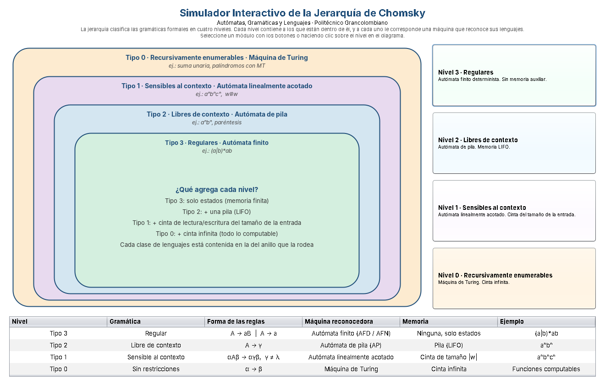
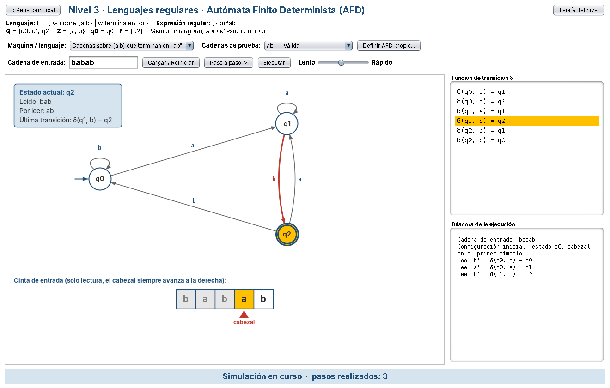
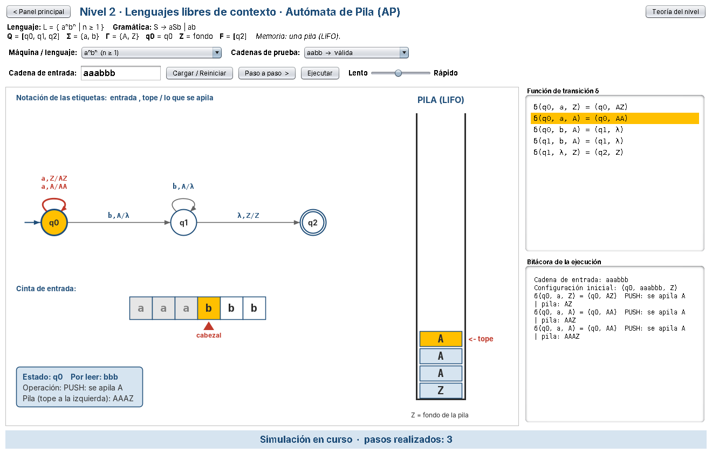
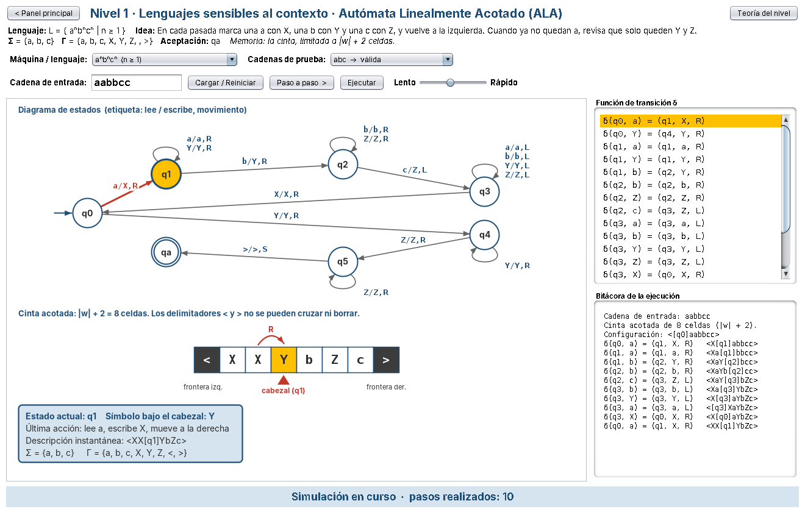
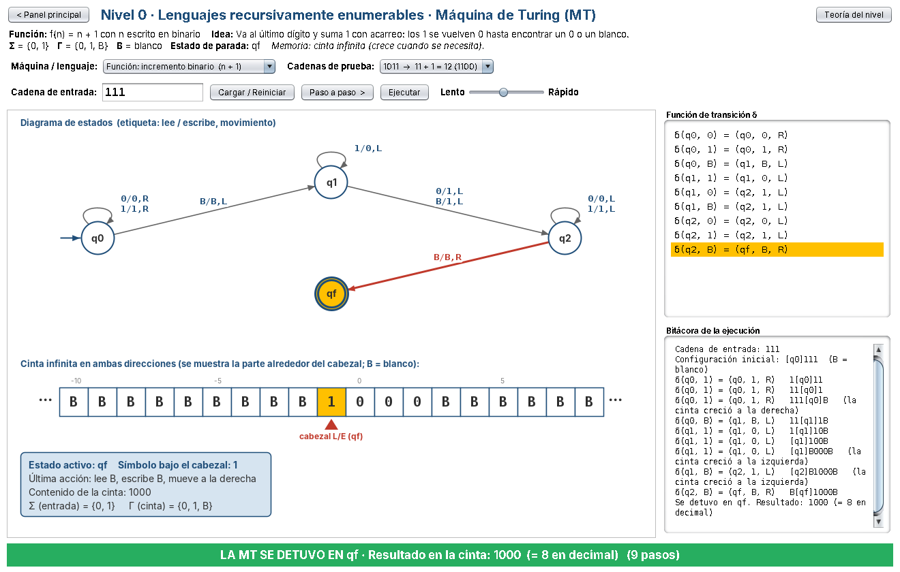

# Simulador Interactivo de la Jerarquía de Chomsky

Proyecto del tercer corte de **Autómatas, Gramáticas y Lenguajes** — Politécnico Grancolombiano.
Autor: **Jeison Felipe Hernández Barajas** · Profesor: **Juan Salazar Ripoll**

Aplicación de escritorio en **Java (Swing)** que permite visualizar y simular, paso a paso, el modelo computacional de cada uno de los cuatro niveles de la jerarquía de Chomsky:

| Nivel | Tipo de lenguaje | Máquina simulada | Qué se ve en la interfaz |
|---|---|---|---|
| 3 | Regular | Autómata Finito Determinista (AFD) | Diagrama de estados, estado actual resaltado y cinta de entrada leída símbolo a símbolo |
| 2 | Libre de contexto | Autómata de Pila (AP) | Pila animada (los símbolos bajan al apilar y suben al desapilar) mientras se consume la cadena |
| 1 | Sensible al contexto | Autómata Linealmente Acotado (ALA) | Cinta acotada con los delimitadores `<` y `>`, movimiento izquierda/derecha del cabezal |
| 0 | Recursivamente enumerable | Máquina de Turing (MT) | Cinta infinita que crece, alfabeto de la cinta, cabezal de lectura/escritura y estado activo |



---

## 1. Requisitos

- **JDK 8 o superior** (probado con JDK 21). Se verifica con `java -version` y `javac -version`.
- No necesita librerías externas, Maven ni Gradle: solo Java estándar (`javax.swing` y `java.awt`).

## 2. Cómo ejecutar el proyecto

### Opción A: abrir el programa ya compilado (la más rápida)
- **Windows:** doble clic en **`ejecutar.bat`**. Busca Java en el equipo (JAVA_HOME, PATH y las carpetas donde lo instalan Oracle, Adoptium, Microsoft, IntelliJ IDEA o Android Studio) y abre `dist/SimuladorChomsky.jar`. Solo necesita Java, no hace falta compilar.
- **Cualquier sistema, desde la terminal:**
```bash
java -jar dist/SimuladorChomsky.jar
```
Si el sistema dice que no encuentra Java, instale un JDK (por ejemplo [Eclipse Temurin 21](https://adoptium.net)) y en el instalador active *Set JAVA_HOME variable* y *Add to PATH*.

### Opción B: compilar el código fuente
- **Windows:** doble clic en **`compilar_y_ejecutar.bat`** (necesita el JDK; si no lo encuentra, abre la versión ya compilada).
- **Desde la terminal:**
```bash
git clone <URL-del-repositorio>
cd SimuladorChomsky
mkdir out
javac -encoding UTF-8 -d out src/*.java
java -cp out SimuladorChomsky
```
En Windows se cambia `src/*.java` por `src\*.java`. En Linux/Mac también se puede usar `./ejecutar.sh`.

### Opción C: IntelliJ IDEA / NetBeans / Eclipse
1. *File → Open* y seleccionar la carpeta del proyecto.
2. Marcar la carpeta `src` como *Sources Root* (clic derecho → *Mark Directory as → Sources Root*).
3. Abrir `src/SimuladorChomsky.java` y ejecutar el método `main` (botón ▶).

## 3. Cómo se usa

1. En el **panel principal** se elige un nivel con los botones de la derecha o haciendo clic sobre el nivel en el diagrama.
2. En cada módulo:
   - **Máquina / lenguaje:** escoge el autómata o la máquina que se quiere simular.
   - **Cadenas de prueba:** lista con cadenas válidas e inválidas ya cargadas. Al elegir una se coloca en el campo de entrada.
   - **Cadena de entrada:** también se puede escribir cualquier cadena y presionar *Enter* o **Cargar / Reiniciar**.
   - **Paso a paso:** ejecuta un solo movimiento de la máquina.
   - **Ejecutar / Pausar:** corre la simulación automáticamente; la barra *Lento – Rápido* cambia la velocidad.
   - **Teoría del nivel:** abre la explicación formal del nivel (gramática, definición de la máquina, memoria y límites).
3. A la derecha se resalta en amarillo la **transición δ** que se acaba de aplicar y la **bitácora** registra cada paso.
4. Abajo aparece el resultado: **verde = aceptada** (o la MT se detuvo con el resultado), **rojo = rechazada**.

En el Nivel 3 el botón **Definir AFD propio...** permite escribir un autómata cualquiera (lenguaje parametrizable) con este formato:
```
inicial: q0
finales: q1
q0 0 q1
q0 1 q0
q1 0 q0
q1 1 q1
```
El programa valida que sea determinista y genera solo las cadenas de prueba de ese autómata.

## 4. Cadenas de prueba por nivel

Todas estas cadenas están incluidas en la lista **Cadenas de prueba** de cada módulo. La cadena vacía se escribe dejando el campo en blanco (en la lista aparece como `λ`).

### Nivel 3 — Autómata Finito Determinista

| Máquina | Válidas (se aceptan) | Inválidas (se rechazan) |
|---|---|---|
| Terminan en `ab` — `(a\|b)*ab` | `ab`, `aab`, `babab`, `bbaab` | `abba`, `ba`, `λ` |
| Binarios múltiplos de 3 | `11` (3), `110` (6), `1001` (9), `1111` (15) | `10` (2), `111` (7), `1010` (10) |
| Contienen `aba` | `aba`, `bbabaa`, `aabab` | `abba`, `bbbb`, `abbab` |
| AFD propio (ejemplo: número impar de ceros) | `0`, `01`, `10`, `000` | `λ`, `1`, `00` |

### Nivel 2 — Autómata de Pila

| Máquina | Válidas | Inválidas |
|---|---|---|
| aⁿbⁿ (n ≥ 1) | `ab`, `aabb`, `aaabbb`, `aaaabbbb` | `aab`, `abb`, `abab`, `λ` |
| Paréntesis balanceados | `(())()`, `((()))`, `()()()`, `λ` | `(()`, `())(`, `)(` |
| w c wᴿ (palíndromo con marca) | `abcba`, `abbcbba`, `c`, `baacaab` | `abcab`, `abba`, `acaa` |

### Nivel 1 — Autómata Linealmente Acotado

| Máquina | Válidas | Inválidas |
|---|---|---|
| aⁿbⁿcⁿ (n ≥ 1) | `abc`, `aabbcc`, `aaabbbccc` | `aabbc`, `abcabc`, `aabcc`, `acb` |
| Lenguaje copia w#w | `ab#ab`, `abb#abb`, `#`, `baab#baab` | `ab#ba`, `ab#abb`, `abab` |

### Nivel 0 — Máquina de Turing

| Máquina | Entrada → resultado esperado |
|---|---|
| Suma en unario (función) | `111+11` → `11111` (3+2=5) · `1+1` → `11` · `1111+111` → `1111111` · `+11` → `11` · `11+` → `11` · `111` → se detiene sin terminar (falta el `+`) |
| Incremento binario (función) | `1011` → `1100` (11+1=12) · `111` → `1000` (7+1=8, la cinta crece a la izquierda) · `1000` → `1001` · `0` → `1` · `1` → `10` · `11111` → `100000` |
| Palíndromos sobre {a,b} (aceptación) | Válidas: `abba`, `aba`, `babbab`, `λ` · Inválidas: `ab`, `abab`, `aab` |

## 5. Estructura del proyecto

El código está en **6 clases** para que sea fácil de leer y explicar:

```
SimuladorChomsky/
├── src/
│   ├── SimuladorChomsky.java   Ventana principal (main) y panel con la jerarquía
│   ├── PanelSimulador.java     Clase base abstracta: controles, temporizador, bitácora y dibujo común
│   ├── PanelAFD.java           Nivel 3: autómata finito determinista
│   ├── PanelAP.java            Nivel 2: autómata de pila
│   ├── PanelALA.java           Nivel 1: autómata linealmente acotado
│   └── PanelMT.java            Nivel 0: máquina de Turing
├── dist/SimuladorChomsky.jar   Ejecutable listo
├── docs/capturas/              Capturas de la interfaz
├── ejecutar.bat               Abre el JAR en Windows (solo necesita Java)
├── compilar_y_ejecutar.bat    Compila src/ y ejecuta (necesita el JDK)
├── ejecutar.sh                Compila y ejecuta en Linux/Mac
└── README.md
```

```
                 JPanel
                   │
           PanelSimulador  (abstracta)
     ┌─────────┬───┴─────┬──────────┐
 PanelAFD   PanelAP   PanelALA   PanelMT
```

**Idea de diseño:** `PanelSimulador` tiene todo lo que se repite (botones, lista δ, bitácora, temporizador, métodos para dibujar estados, flechas y cintas). Cada nivel hereda de ella e implementa solo tres cosas: `iniciar()` (configuración inicial), `paso()` (un movimiento de la máquina) y `dibujar()` (cómo se ve). Las transiciones de cada máquina se guardan como tablas (`String[][]` o `Map`), igual que la función δ de la definición formal.

## 6. Conceptos aplicados (resumen)

- **Nivel 3:** M = (Q, Σ, δ, q0, F). Sin memoria auxiliar: solo el estado actual. Cada AFD muestra su gramática regular equivalente (A → aB).
- **Nivel 2:** M = (Q, Σ, Γ, δ, q0, Z, F). Pila LIFO; transiciones δ(q, a, X) = (p, γ). Aceptación por estado final.
- **Nivel 1:** Máquina de Turing restringida a |w| + 2 celdas, con delimitadores `<` `>` que no se pueden cruzar ni borrar. Marca símbolos y se mueve en ambas direcciones.
- **Nivel 0:** M = (Q, Σ, Γ, δ, q0, B, F). Cinta infinita (crece con blancos `B`), sirve para aceptar lenguajes y para calcular funciones. Límite de seguridad de 5000 pasos (problema de la parada).

La explicación completa está en el documento del proyecto y en el botón **Teoría del nivel** de cada módulo.

## 7. Capturas

| Nivel 3 (AFD) | Nivel 2 (AP) |
|---|---|
|  |  |

| Nivel 1 (ALA) | Nivel 0 (MT) |
|---|---|
|  |  |
